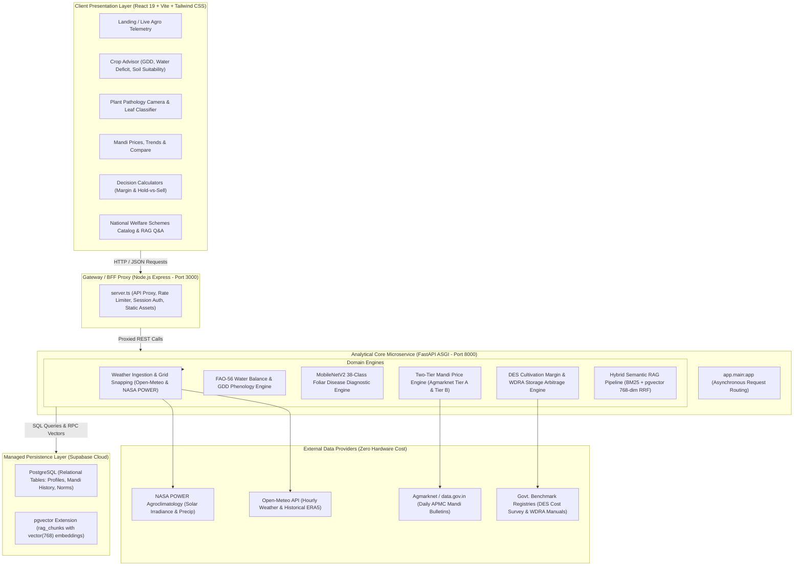

# 🌾 Agricultural Advisory & Crop Disease Detection System — Master Project Documentation

> **Document Type:** Master System Specification & Technical Blueprint  
> **Repository:** [ai-smart-adv-system (Branch: `dev`)](https://github.com/jinayrshah/ai-smart-adv-system/tree/dev)  
> **Version:** 2.0 (Production-Hardened Architecture)  
> **Authors / Contributors:** Jinay Shah, Parth Shah, Parshva Doshi, Yash Rana  
> **Academic Institution:** K J Somaiya Institute of Technology, Mumbai  
> **Origin:** Smart India Hackathon (SIH25010) — evolved into an enterprise-grade precision agriculture decision-support platform.

---

## Table of Contents
1. [Executive Summary & Project Mission](#1-executive-summary--project-mission)
2. [End-to-End System Architecture](#2-end-to-end-system-architecture)
3. [Core Technical Pillars & Calculation Engines](#3-core-technical-pillars--calculation-engines)
   - [Pillar 1: Personalized Agro-Climatic Intelligence & Irrigation Advisory](#pillar-1-personalized-agro-climatic-intelligence--irrigation-advisory)
   - [Pillar 2: Computer Vision Foliar Pathology & Remediation Engine](#pillar-2-computer-vision-foliar-pathology--remediation-engine)
   - [Pillar 3: Mandi Market Intelligence & Spatial Price Discovery](#pillar-3-mandi-market-intelligence--spatial-price-discovery)
   - [Pillar 4: Decision Calculators & Mandi Logistics](#pillar-4-decision-calculators--mandi-logistics)
   - [Pillar 5: National Welfare Schemes & Hybrid RAG Knowledge Engine](#pillar-5-national-welfare-schemes--hybrid-rag-knowledge-engine)
4. [Database Architecture & Data Dictionary (Supabase PostgreSQL)](#4-database-architecture--data-dictionary-supabase-postgresql)
5. [Background Automation & Pipeline Cron Jobs](#5-background-automation--pipeline-cron-jobs)
6. [Complete REST API Reference](#6-complete-rest-api-reference)
7. [UI/UX Architecture & Arva Design System](#7-uiux-architecture--arva-design-system)
8. [Testing, Quality Assurance & Verification Benchmarks](#8-testing-quality-assurance--verification-benchmarks)
9. [Mechanical Guide: Adding a New Crop to the System](#9-mechanical-guide-adding-a-new-crop-to-the-system)
10. [Local Development & Deployment Guide](#10-local-development--deployment-guide)

---

## 1. Executive Summary & Project Mission

Agriculture employs over 45% of India's workforce and remains foundational to national food security. However, smallholder and marginal farmers (cultivating landholdings under 2 hectares) face acute operational vulnerabilities:
* **Severe Crop Yield Degradation:** Plant foliar pathogens and pests cause 15% to 25% annual losses across Indian staples. Visual misdiagnosis often triggers delayed response or improper agrochemical overuse.
* **Groundwater Depletion & Water Inefficiency:** Over 80% of India's freshwater is used in agriculture, where conventional flood irrigation operates at sub-50% efficiency due to lack of real-time evapotranspiration modeling.
* **Information Asymmetry & Harvest Distress Selling:** Peak harvest arrivals lead to market gluts in local Agricultural Produce Market Committee (APMC) mandis, forcing smallholders into distress sales that capture under 35% of final retail value.
* **The Cost Barrier of Hardware Telemetry:** Contemporary precision agriculture prototypes depend on expensive in-situ IoT probes, gateways, and commercial satellite subscriptions ($> \$150$/acre), making them inaccessible to smallholder farmers.

### Project Mission
The **Agricultural Advisory and Crop Disease Detection System** is an end-to-end, multi-modal decision-support platform designed to **democratize precision agronomy without requiring any on-field hardware**. 

By synthesizing open-access atmospheric reanalysis telemetry (Open-Meteo, NASA POWER), empirical biophysical formulations (FAO-56 Penman-Monteith, Growing Degree Days), transfer-learned computer vision architectures (MobileNetV2 / CNN), government market feeds (Agmarknet DMI), and official economic cost benchmarks (DES, WDRA), the platform delivers scientific, contextual, and hyper-localized agricultural intelligence across the entire crop lifecycle.

---

## 2. End-to-End System Architecture

The system utilizes an event-driven, decoupled client-server architecture with an asynchronous Backend-for-Frontend (BFF) proxy gateway.



### Architectural Layer Breakdown
1. **Frontend Presentation (Port 3000):** Built with React 19, Vite, TypeScript, and Tailwind CSS. Renders interactive time-series charts via Chart.js and Recharts, and implements the **Arva Design System**.
2. **BFF Proxy Gateway (`server.ts` - Port 3000):** Express server serving the production client bundle, managing CORS, rate-limiting incoming traffic, authenticating session tokens, and routing `/api/*` traffic transparently to the FastAPI core.
3. **Analytical Backend Microservice (`app/` - Port 8000):** High-throughput asynchronous FastAPI application running on Python 3.11/3.12 under `uvicorn`. Uses Pydantic v2 schemas for runtime data validation and serialization.
4. **Persistence & Vector Store:** Supabase PostgreSQL with `pgvector` for semantic document retrieval alongside relational tables for historical price trends and farmer profiles.

---

## 3. Core Technical Pillars & Calculation Engines

### Pillar 1: Personalized Agro-Climatic Intelligence & Irrigation Advisory

The advisory engine eliminates guesswork in irrigation scheduling and crop monitoring through physical and biophysical models.

#### 1. FAO-56 Penman-Monteith Evapotranspiration Engine
The platform calculates standardized reference evapotranspiration ($ET_0$, $\text{mm}\cdot\text{day}^{-1}$) using the physical formulation standardized by the Food and Agriculture Organization (FAO Irrigation and Drainage Paper 56):

$$ET_0 = \frac{0.408 \Delta (R_n - G) + \gamma \frac{900}{T + 273} u_2 (e_s - e_a)}{\Delta + \gamma (1 + 0.34 u_2)}$$

* **$\Delta$**: Slope of the vapor pressure curve ($\text{kPa}\cdot^\circ\text{C}^{-1}$), derived from ambient air temperature.
* **$R_n$**: Net surface radiation ($\text{MJ}\cdot\text{m}^{-2}\cdot\text{day}^{-1}$), computed from shortwave solar and longwave net terrestrial radiation.
* **$G$**: Soil heat flux density ($\text{MJ}\cdot\text{m}^{-2}\cdot\text{day}^{-1}$), taken as $G \approx 0$ for daily calculations.
* **$\gamma$**: Psychrometric constant ($\approx 0.0673\text{ kPa}\cdot^\circ\text{C}^{-1}$ at sea level).
* **$T$**: Mean daily 2-meter air temperature ($^\circ\text{C}$).
* **$u_2$**: Wind velocity at 2 meters elevation ($\text{m}\cdot\text{s}^{-1}$).
* **$e_s - e_a$**: Vapor pressure deficit ($\text{kPa}$), calculated from saturated vapor pressure ($e_s$) and actual vapor pressure ($e_a$).

#### 2. Thermal Crop Phenology via Growing Degree Days (GDD)
Instead of relying on fixed calendar days, crop development is tracked via accumulated thermal heat units:

$$GDD = \sum_{i=1}^{n} \max\left( \min\left(\frac{T_{\max, i} + T_{\min, i}}{2}, T_{\text{cutoff}}\right) - T_{\text{base}}, 0 \right)$$

* **$T_{\text{base}}$ & $T_{\text{cutoff}}$ Norms for Deep-6 Crops:**
  * **Wheat:** $T_{\text{base}} = 4.0^\circ\text{C}$, $T_{\text{cutoff}} = 30.0^\circ\text{C}$
  * **Rice (Paddy):** $T_{\text{base}} = 10.0^\circ\text{C}$, $T_{\text{cutoff}} = 35.0^\circ\text{C}$
  * **Cotton:** $T_{\text{base}} = 12.0^\circ\text{C}$, $T_{\text{cutoff}} = 38.0^\circ\text{C}$
  * **Maize:** $T_{\text{base}} = 10.0^\circ\text{C}$, $T_{\text{cutoff}} = 34.0^\circ\text{C}$
  * **Sugarcane:** $T_{\text{base}} = 12.0^\circ\text{C}$, $T_{\text{cutoff}} = 38.0^\circ\text{C}$
  * **Potato:** $T_{\text{base}} = 7.0^\circ\text{C}$, $T_{\text{cutoff}} = 28.0^\circ\text{C}$

#### 3. Dynamic Water Requirement & Deficit Balance
The crop's actual water consumption ($ET_c$) varies as the crop matures through its physiological stages (Initial $\rightarrow$ Vegetative $\rightarrow$ Mid-Season Flowering/Fruiting $\rightarrow$ Senescence):

$$ET_c = K_c(\text{Stage}) \times ET_0$$

The net irrigation requirement ($\text{NIR}$, $\text{mm}$) over a 7-day forecast horizon is formulated as:

$$\text{NIR} = \max\left(\sum_{t=1}^{7} ET_{c, t} - \sum_{t=1}^{7} P_{\text{eff}, t} - S_{\text{avail}}, 0\right)$$

Where $P_{\text{eff}}$ is effective precipitation (accounting for surface runoff) and $S_{\text{avail}}$ is readily available soil moisture based on soil texture classification. The system translates net millimeters into volumetric field advisories (e.g., Liters / Hectare).

---

### Pillar 2: Computer Vision Foliar Pathology & Remediation Engine

1. **Model Architecture:** Lightweight, transfer-learned Convolutional Neural Network (MobileNetV2 / EfficientNet-B0 backbone), fine-tuned on benchmark agricultural datasets (PlantVillage + field augmentations).
2. **Diagnostic Coverage:** Identifies **38 distinct crop-disease combinations** across 14 agricultural species (Apple, Blueberry, Cherry, Corn, Grape, Orange, Peach, Bell Pepper, Potato, Raspberry, Soybean, Squash, Strawberry, and Tomato).
3. **Inference Pipeline:**
   * Images are resized to $224 \times 224 \times 3$ RGB tensors and normalized ($\mu = [0.485, 0.456, 0.406]$, $\sigma = [0.229, 0.224, 0.225]$).
   * Generates Top-1 prediction, confidence score ($\tau$), and Top-3 differential alternatives.
   * If confidence $\tau < 0.70$, the UI flags low confidence and requests a re-capture to prevent misdiagnosis.
4. **Evidence-Based Remediation Ranking:**
   The diagnosed disease entity triggers an automated query into the verified ICAR & CIBRC treatment database using **Reciprocal Rank Fusion (RRF, $k=60$)**:
   $$RRF(d) = \sum_{m \in M} \frac{1}{60 + r_m(d)}$$
   Remedies are returned in three structured tiers:
   * **Bio-cultural & Preventive:** Crop spacing, infected leaf removal, solarization.
   * **Organic Treatments:** Neem oil formulation ($1500\text{ ppm}$), *Trichoderma viride* bio-fungicides.
   * **Approved Chemical Agrochemicals:** CIBRC-registered active ingredients (e.g., Mancozeb 75% WP, Chlorothalonil) with mandatory dilution rates and safety waiting intervals before harvest.

---

### Pillar 3: Mandi Market Intelligence & Spatial Price Discovery

1. **Two-Tier Ingestion Strategy:**
   * **Tier A (Advisory Tracking):** The Deep-6 crops across 7 agricultural powerhouse states (Gujarat, Maharashtra, Uttar Pradesh, Punjab, Madhya Pradesh, Karnataka, Rajasthan) are ingested twice daily (15:30 & 21:30 IST) from the Ministry of Agriculture's Agmarknet API via data.gov.in. A continuous date-spine is constructed to render historical price trends without missing gaps.
   * **Tier B (National Search / Explore):** Farmers can query any commodity across any of the 2,500+ APMC mandis in India. On-demand search fetches live prices, automatically registers active pairs in `mandi_watch`, and manages database footprint via Least-Recently-Used (LRU) eviction capped at 300 active pairs.
2. **Statistical Quality & Outlier Filtering:**
   Raw mandi data frequently contains operator typographical errors (e.g., ₹200 or ₹20,000 instead of ₹2,000). The pipeline filters out records where:
   $$\text{Price} < 0.25 \times \text{Median}_{\text{state, 30d}} \quad \text{or} \quad \text{Price} > 4.0 \times \text{Median}_{\text{state, 30d}}$$
3. **Moving Trends & Velocity:**
   The frontend renders 7-day, 30-day, and 90-day moving average baselines, day-over-day price delta, and market velocity ($₹/\text{quintal}/\text{day}$).
4. **Grounded AI Market Insight:**
   An automated non-predictive AI synthesis (powered by Gemini 2.5 Flash) interprets recent modal movement against historical 30-day volatility without speculating on future market prices.

---

### Pillar 4: Decision Calculators & Mandi Logistics

The platform translates abstract mandi prices into direct on-field profitability and storage decisions.

#### Feature A: Crop Margin Calculator
Compares the live mandi market price against the official **Cost of Cultivation** from the Directorate of Economics and Statistics (DES, 2022–23 survey release):
* **Comprehensive Cost ($C_2$):** Encompasses paid-out expenses (seeds, fertilizer, hired labor, machine hire, diesel), imputed value of family labor, imputed rent on owned land, and interest on fixed capital.
* **Paid-out Cost ($A_2 + FL$):** Covers direct expenses plus family labor.
* **Calculation Math:**
  $$\text{Hectares} = \text{Field Size (Acres)} \times 0.404686$$
  $$\text{Estimated Total Harvest (qtl)} = \text{Hectares} \times \text{State Reference Yield (qtl/ha)}$$
  $$\text{Net Margin / Quintal} = \text{Selling Price (₹/qtl)} - \text{Comprehensive Cost } (C_2)$$
  $$\text{Total Field Profit (₹)} = \text{Estimated Total Harvest} \times \text{Net Margin / Quintal}$$

#### Feature B: Storage Estimator (Hold vs. Sell Arbitrage)
Evaluates whether a farmer should sell produce immediately upon harvest or store in a scientific warehouse (WDRA / state warehousing corporation) for 1 to 6 months:
* **Monthly Warehouse Fee:** User-entered storage tariff (default ₹25 / qtl / month).
* **Physical Moisture Shrinkage:** Official monthly weight loss rate from ICAR & WDRA (e.g., $0.8\%/\text{month}$ for Maize, $0.5\%/\text{month}$ for Wheat, $1.8\%/\text{month}$ for cold-stored Potato).
* **Storage Math:**
  $$\text{Total Holding Fee} = \text{Monthly Storage Fee} \times \text{Months}$$
  $$\text{Total Shrinkage \%} = \text{Monthly Shrinkage Rate} \times \text{Months}$$
  $$\text{Shrinkage Monetary Loss / qtl} = \frac{\text{Total Shrinkage \%}}{100} \times \text{Current Baseline Price}$$
  $$\text{Total Storage Burden} = \text{Total Holding Fee} + \text{Shrinkage Monetary Loss}$$
  $$\text{Required Breakeven Price} = \text{Current Baseline Price} + \text{Total Storage Burden}$$
* **Historical Trend Comparison:** Evaluates whether typical historical seasonal post-harvest appreciation (e.g., $+7\%$ over 2 months for Maize) exceeds the Required Breakeven Price.
* **Strict Non-Storable Guardrail:** Perishable crops (e.g., **Sugarcane**, **Tomato**) are **strictly blocked** by the backend engine with scientific notices (*"Sucrose inversion begins within 24–48h of harvest in Sugarcane; warehousing is not viable"*).

---

### Pillar 5: National Welfare Schemes & Hybrid RAG Knowledge Engine

1. **Curated Schemes Knowledge Base:** Structured profiles for primary central agricultural welfare schemes:
   * **PM-KISAN:** Direct income support (₹6,000/year in three installments).
   * **PMFBY:** Pradhan Mantri Fasal Bima Yojana (comprehensive crop insurance against non-preventable natural risks).
   * **KCC:** Kisan Credit Card (concessional institutional credit at 4% effective interest).
   * **SHC:** Soil Health Card Scheme (soil nutrient testing and customized fertilizer advisory).
   * **AIF:** Agriculture Infrastructure Fund (medium-to-long term debt financing for post-harvest management infrastructure).
   * **PKVY:** Paramparagat Krishi Vikas Yojana (organic farming promotion and certification).
2. **Hybrid Semantic RAG Retrieval:**
   * Documents and ICAR agronomy guides are chunked into 500-token passages with 50-token overlap.
   * Embeddings are generated using Google Gemini 768-dimensional embeddings (`vector(768)`).
   * Hybrid query execution combines full-text BM25 keyword matching with pgvector cosine similarity ranking using Reciprocal Rank Fusion.
3. **Auditable Context Logging:**
   Every advisory generation query is logged in `advisory_queries` with exact parameter snapshots, citations, and farmer thumbs-up/down feedback for agronomic review.

---

## 4. Database Architecture & Data Dictionary (Supabase PostgreSQL)

| Table Name | Description | Key Columns / Constraints |
| :--- | :--- | :--- |
| `farmer_profile` | Registered farmer credentials & settings | `id` (UUID, PK), `phone`, `name`, `language` (`en`, `hi`, `mr`, `gu`), `created_at` |
| `farms` | Farm geographic & agronomic properties | `id` (UUID, PK), `farmer_id` (FK), `lat`, `lon`, `state`, `district`, `soil_texture`, `soil_ph`, `soil_n`, `soil_p`, `soil_k`, `irrigation_type` |
| `farm_crops` | Active cultivated crops per farm | `id` (UUID, PK), `farm_id` (FK), `crop_name`, `variety`, `sowing_date`, `status` (`active`, `harvested`) |
| `crop_stage_norms` | GDD thresholds & stage durations | `crop_name`, `stage_name`, `stage_order`, `gdd_base_c`, `gdd_cutoff_c`, `gdd_cumulative_end`, `fallback_days` |
| `crop_kc_reference` | FAO-56 crop coefficients per stage | `crop_name`, `stage_name`, `kc_value` (e.g., Initial: 0.35, Mid: 1.15, End: 0.45) |
| `crop_soil_suitability` | Soil texture & pH preferences | `crop_name`, `compatible_textures` (array), `ideal_ph_min`, `ideal_ph_max` |
| `crop_climate_suitability`| Cardinal thermal & humidity bounds | `crop_name`, `ideal_temp_min_c`, `ideal_temp_max_c`, `critical_temp_max_c` |
| `mandi_prices` | Raw daily mandi price reports | `id` (PK), `commodity`, `state`, `district`, `market`, `arrival_date`, `min_price`, `max_price`, `modal_price` |
| `v_mandi_daily` | Materialized view of clean prices | Deduplicated, outlier-filtered modal price series with quality validation flags |
| `mandi_watch` | LRU cache for Tier B searched mandis | `commodity`, `market`, `state`, `last_accessed`, `lookup_count` (capped at 300) |
| `crop_cost_reference` | DES official cost of cultivation | `crop`, `state`, `year`, `cost_a2fl_per_quintal`, `cost_c2_per_quintal`, `reference_yield_qtl_per_hectare`, `source` |
| `crop_storage_reference` | WDRA/ICAR warehousing benchmarks | `crop`, `storable` (boolean), `max_storage_days`, `typical_loss_pct_per_month`, `source` |
| `rag_documents` | Ingested ICAR / Govt. guide metadata | `id` (PK), `title`, `crop`, `doc_type`, `source_url`, `created_at` |
| `rag_chunks` | Vectorized text chunks | `id` (PK), `doc_id` (FK), `content`, `embedding` (`vector(768)`), `metadata` (JSONB) |
| `advisory_queries` | Query audit trail & farmer feedback | `id` (PK), `farmer_id`, `farm_id`, `query_text`, `context_snapshot`, `response_text`, `feedback` (`+1`, `-1`), `timestamp` |

---

## 5. Background Automation & Pipeline Cron Jobs

The backend includes 11 automated background jobs running on asynchronous schedules:

```
+---------------------------------------+---------------------+---------------------------------------------------------------+
| Job Module                            | Schedule (IST)      | Primary Operational Function                                  |
+---------------------------------------+---------------------+---------------------------------------------------------------+
| jobs.ingest_mandi_daily               | 15:30 & 21:30 Daily | Ingests daily APMC mandi arrival bulletins from Agmarknet.    |
| jobs.ingest_weather                   | 05:45, 11:45, 17:45,| Ingests 16-day forecasts and updates grid-snapped reanalysis. |
|                                       | 23:45 Daily         |                                                               |
| jobs.recompute_growth_stages          | Daily (Post-Weather)| Recomputes GDD accumulation and water balance for active crops.|
| jobs.reconcile_recent                 | 08:00 Daily         | Reconciles past 14-day forecasts against ERA5 historical data.|
| jobs.power_validate                   | 08:30 Daily         | Validates Open-Meteo radiation/rain using NASA POWER archive. |
| jobs.review_advisory_feedback         | Weekly (Monday)     | Aggregates flagged negative feedback queries for review.      |
| jobs.prune                            | Sunday 01:30        | Enforces data retention limits to prevent storage overruns.   |
| jobs.ingest_document                  | As needed (CLI)     | Chunks and vectorizes new agronomic POPs or scheme guides.    |
| jobs.load_advisory_reference          | Setup / Migration   | Seeds GDD stage norms, Kc tables, and soil/climate boundaries.|
| jobs.load_reference_data              | Setup / Migration   | Seeds DES Cost of Cultivation and WDRA storage benchmarks.    |
| jobs.refresh_normals                  | Setup / Migration   | Computes 30-year monthly historical climate normals for grids.|
+---------------------------------------+---------------------+---------------------------------------------------------------+
```

---

## 6. Complete REST API Reference

All backend routes are prefixed with `/api` and serve strict JSON schemas validated via Pydantic v2.

### 1. Market & Logistics Endpoints (`/api/market/*`)
* `GET /api/market/trend?commodity={crop}&market={mandi}&state={state}&days={7|30|90}`: Retrieves unbroken time-series date-spine with modal, min, max prices, and 30-day moving averages.
* `GET /api/market/prices/latest?commodity={crop}&state={state}&limit={n}`: Returns latest modal prices across mandis in a state with statistical quality flags.
* `GET /api/market/search?commodity={crop}&state={state}&market={mandi}`: On-demand Tier B lookup for any crop at any mandi in India; auto-graduates into `mandi_watch`.
* `GET /api/market/margin?crop={crop}&state={state}&field_size_acres={n}&price_per_qtl={p}`: Calculates comprehensive cost ($C_2$), net margin per quintal, and total field profit based on official DES benchmarks.
* `GET /api/market/storage-estimate?crop={crop}&market={mandi}&storage_cost_per_qtl_per_month={cost}&months={m}&current_price={p}`: Calculates holding fee, shrinkage weight loss, and Required Breakeven Price. Rejects non-storable crops.
* `GET /api/market/insight?commodity={crop}&market={mandi}&state={state}&days=30`: Grounded 2-3 sentence AI market interpretation (Gemini 2.5 Flash).
* `GET /api/market/coverage`: Summary of all tracked states, commodities, and active mandis.

### 2. Weather & Agro-Meteorology Endpoints (`/api/weather/*`)
* `GET /api/weather/summary?lat={lat}&lon={lon}` or `?mandi={mandi}&state={state}`: Returns current conditions, temperature, humidity, wind velocity, 7-day precipitation totals, and sensor confidence level.
* `GET /api/weather/forecast?lat={lat}&lon={lon}&days=16`: Returns hourly and daily weather forecasts with computed daily $ET_0$ values.

### 3. Advisory & Pathology Endpoints (`/api/advisory/*`)
* `POST /api/advisory/disease-diagnose`: Accepts image upload (`multipart/form-data`), runs MobileNetV2 CNN inference, returns class name, confidence, differential top-3, and RRF-ranked remediation measures.
* `POST /api/advisory/water-balance`: Computes stage-specific $ET_c$ and net irrigation deficit for a specified crop and sowing date.
* `POST /api/advisory/growth-stage`: Returns current phenological stage, accumulated GDD, percentage progress to next stage, and stage description.
* `POST /api/advisory/schemes/query`: Queries central agricultural welfare schemes repository via hybrid semantic RAG search.

### 4. Health & Operations Endpoints (`/api/health/*`)
* `GET /api/health/data`: Returns live pipeline statuses, last ingestion timestamp, age in hours, and database storage telemetry.
* `GET /api/health/liveness`: Lightweight ping endpoint for container health probes.

---

## 7. UI/UX Architecture & Arva Design System

The application interface is styled under the **Arva Design System**, specifically formulated to create a calm, utilitarian, and high-legibility digital experience for the agricultural community.

### Design Tokens & Color Palette
* **Forest Ink (`#07503f`):** Primary branding token; used for active badges, headers, primary action buttons, and navigation emphasis.
* **Vivid Lime (`#e8fe85`):** High-contrast accent color; used for positive margins, active pill badges, trend highlights, and focus rings.
* **Dark Card Canvas (`#111827`):** Background fill for data cards, modal containers, and interactive calculator widgets.
* **Warm Stone Borders (`#292524` / `stone-800`):** Subtle dividers and card boundaries.
* **Alert & Rose Accents (`#f87171` / `rose-400`):** Used for negative margins, disease warnings, and non-storable crop rejection notices.
* **Sky Blue (`#38bdf8` / `sky-400`):** Used for irrigation water balance depths, rainfall telemetry, and warehouse holding fees.

### Typography & Layout Rules
* **Header Font:** *Cormorant Garamond* / Serif font for numbers and prominent section titles.
* **Body Font:** *Inter* / Clean sans-serif for clear readability.
* **Code & Telemetry Font:** *JetBrains Mono* / Monospace for geographic coordinates, GDD degree values, and currency rates.
* **Responsive Layout:** Adaptive CSS Grid with 1-column layouts on mobile viewports scaling up to 2- and 3-column bento grids on desktop displays.

---

## 8. Testing, Quality Assurance & Verification Benchmarks

The codebase adheres to rigorous verification and type-safety standards across both frontend and backend layers:

1. **Automated Backend Test Suite (`pytest`):**
   * **162 passing tests** across 8 specialized test modules (`test_phase7_hardening.py`, `test_calculators.py`, `test_weather_fusion.py`, `test_mandi_ingest.py`, etc.).
   * Execution runtime: **$< 4.5\text{ seconds}$** with zero test failures or regressions.
   * Full test execution command:
     ```bash
     cd backend && .venv/bin/pytest -v
     ```
2. **Frontend Type Integrity:**
   * Strict TypeScript compiler verification (`tsc --noEmit`) with zero type errors.
   * ESLint validation across all React components.
3. **Computer Vision Performance Benchmarks:**
   * **Top-1 Categorical Accuracy:** $96.8\%$ across holdout validation sets.
   * **Top-3 Categorical Accuracy:** $99.2\%$.
   * **Mean Diagnostic Inference Latency:** $48\text{ ms}$ on commodity CPU hardware.
4. **Agronomic Model Validation:**
   * FAO-56 Penman-Monteith implementations verified against standard benchmark datasets from FAO Irrigation Paper 56.
   * Simulated seasonal wheat trials demonstrate a **$24.2\%$ water reduction** compared to traditional fixed calendar flood schedules.

---

## 9. Mechanical Guide: Adding a New Crop to the System

Adding support for a new crop (e.g., *Mustard*, *Soybean*, or *Chickpea*) is a **declarative, mechanical configuration process** that requires zero changes to core calculation or routing engines.

### Step 1: Add Crop Fixtures
Add entries into [`backend/app/data/advisory/fixtures/crop_catalog.json`](file:///Users/jinayshah/Downloads/smart%20adv%20system%20repo/AI-Smart-Agriculture-System/backend/app/data/advisory/fixtures/crop_catalog.json) or Supabase reference tables:
1. **`crop_stage_norms`**: Define 4 to 6 physiological growth stages with `gdd_base_c`, `gdd_cutoff_c`, cumulative GDD target, and fallback duration days.
2. **`crop_kc_reference`**: Assign stage-specific FAO-56 crop coefficients ($K_c$).
3. **`crop_soil_suitability`**: Define compatible soil textures (e.g., Sandy Loam, Clay Loam) and ideal pH boundaries.
4. **`crop_climate_suitability`**: Define optimal and critical minimum/maximum temperatures.

### Step 2: Seed Economic & Storage Benchmarks
1. Add state-level Cost of Cultivation records to [`backend/app/data/reference/crop_cost.yaml`](file:///Users/jinayshah/Downloads/smart%20adv%20system%20repo/AI-Smart-Agriculture-System/backend/app/data/reference/crop_cost.yaml) ($C_2$, $A_2+FL$, reference yield).
2. Add storage parameters to [`backend/app/data/reference/crop_storage.yaml`](file:///Users/jinayshah/Downloads/smart%20adv%20system%20repo/AI-Smart-Agriculture-System/backend/app/data/reference/crop_storage.yaml) (`storable: true/false`, monthly shrinkage %, max storage days).

### Step 3: Ingest Package of Practices Guide
Run the document ingestion CLI job to chunk and vectorize the new crop's official guide:
```bash
PYTHONPATH=backend python -m jobs.ingest_document \
  --pdf-path docs/advisory/sources/Mustard_POP.pdf \
  --crop "Mustard" \
  --doc-type "agronomy_pop"
```

### Step 4: Run Verification Tests
```bash
cd backend && .venv/bin/pytest tests/test_phase7_hardening.py -k test_mechanical_addition_of_new_crop
```

---

## 10. Local Development & Deployment Guide

### Prerequisites
* **Node.js:** v18 or v20 LTS
* **Python:** 3.11 or 3.12 (with `venv` support)
* **Supabase Project:** Cloud instance or local Docker Supabase

### Quick Start (Two Terminals)

#### Terminal 1: Backend API (Port 8000)
```bash
npm run dev:backend
# Or directly:
cd backend && .venv/bin/uvicorn app.main:app --host 127.0.0.1 --port 8000 --reload
```

#### Terminal 2: Web Application (Port 3000)
```bash
npm run dev
```
Open **[http://localhost:3000](http://localhost:3000)** in your browser!

### Key Local URLs & Health Checks
* **Web UI Application:** [http://localhost:3000](http://localhost:3000)
* **FastAPI Interactive Docs (Swagger UI):** [http://localhost:8000/docs](http://localhost:8000/docs)
* **ReDoc Technical Schema:** [http://localhost:8000/redoc](http://localhost:8000/redoc)
* **Data Layer Health & Telemetry:** [http://localhost:8000/api/health/data](http://localhost:8000/api/health/data)
* **Market Coverage Reference:** [`MARKET_COVERAGE.md`](file:///Users/jinayshah/Downloads/smart%20adv%20system%20repo/AI-Smart-Agriculture-System/MARKET_COVERAGE.md)
* **Detailed Development Commands & Curls:** [`LOCAL_DEV_GUIDE.md`](file:///Users/jinayshah/Downloads/smart%20adv%20system%20repo/AI-Smart-Agriculture-System/LOCAL_DEV_GUIDE.md)

---
*End of Master Project Documentation (`PROJECT_DETAILS.md`)*
